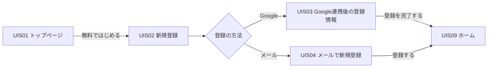
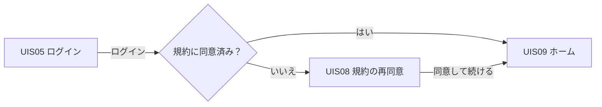
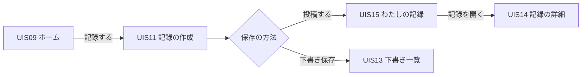
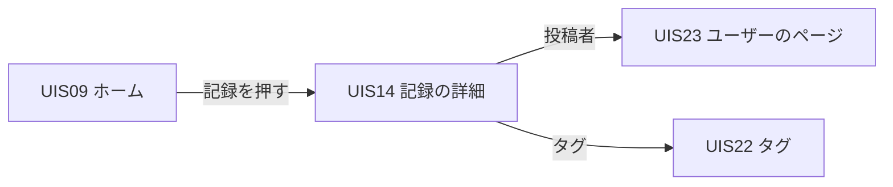
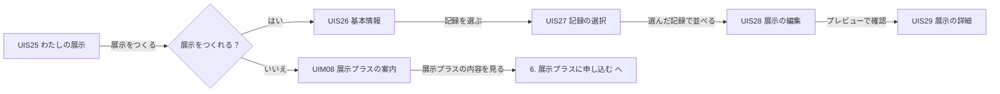
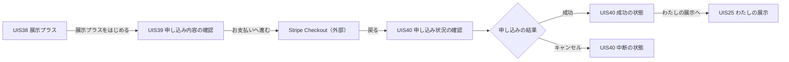

# 画面設計書

初版の画面の一覧と、全画面に共通する動きです。画面ごとの設計は、下の表の ID から開きます。
管理画面は第 2 版で作るため、ここには含めません（[ADR-0014](../12_ADR/0014-管理画面を第2版へ移す.md)）。

画面の構成・文言・ボタン・遷移は、[Figma「01 推しのよりみち・全画面（整理版）」](https://www.figma.com/design/AUNEBoh9AdHbRHwHsyQaHJ?node-id=4-41322) を正とします。UI 全体の参照先は [05_UI設計](../05_UI設計/README.md) にあります。

## 記載方針

- 配置・色や表示項目の全文は Figma を参照する。ここには、イベントを識別する文言、遷移先と表示方法、API の呼び出し、受け渡すパラメータ、入力チェック、状態による表示の切り替えを書く
- 実際のリンクと説明フレームが食い違う場合はリンクを採用し、不整合が残る部分は未確定事項に記す。リンク未設定の操作は、説明フレーム・既存設計・出典で裏付けられる処理だけを書く
- Figma に専用フレームがない保存完了の組み合わせや書き出し失敗の状態は、個別設計書に確定した処理と未反映の範囲を記す。未作成のフレームに架空のノード ID を付けない
- 「イベント概要」は機能単位の整理、「イベント詳細」の「Figma の操作と遷移」は画面モデル単位のリンクを示す。同じ ID のモデル間の遷移は、別画面ではなく状態の切り替えとして扱う
- 料金・時刻・枚数・課金判定などの決定済み条件は出典を保持する。画面と矛盾する条件や、出典にない条件を推測で確定しない
- 画面項目の定義表は作らない。項目数が少なく、Figma と画面モデルを見れば分かるため
- 0 件のとき・フォロー済みのときなど、同じ画面の状態違いは 1 つの画面 ID にまとめ、「画面表示制御」に書く
- API は [`docs/07_API設計書/`](../07_API設計書/README.md) を正とする。「利用API」の表の ID は API 設計書の ID を書く。パラメーターと応答は API 設計書を参照する
- 起動パラメータの `post_id`・`draft_id`・`exhibition_id`・`goods_id`・`export_id`・`user_name`・`tag_name` は API と同じ名前で確定している。`draft_id` と `post_id` は同じ値で、下書きを投稿すると同じ ID の記録になる
- 「未確定」と書いたところは、仕様が決まっていない。推測で埋めない
- 「画面モデル」は、デザインの元資料（life リポジトリ）にある画面の識別子で、Figma のフレーム名とも対応する
- 各画面の先頭に、最初の画面モデルの PC のフレームへのリンクを置く。その下の表に、画面モデルごとの PC・スマホと対応する説明フレームへのリンクを置く

標準画面 54 ID・モーダル 14 ID に、144 画面モデル（PC 143・スマホ 144、計 288 フレーム）を割り当てる。状態違いは同じ ID にまとめる。ID は維持し、追加が必要になった場合は UIS52・UIM09 から採番する。削除した画面は一覧から消さず「欠番（Figma から削除）」と記し、ID を再利用しない。

## 標準画面

| ID | 論理名 | 画面モデル | 備考 |
| --- | --- | --- | --- |
| [UIS01](./UIS01/README.md) | トップページ（LP） | `lp`・`lp_categories_vertical` | 未ログインの入口 |
| [UIS02](./UIS02/README.md) | 新規登録 | `signup` | |
| [UIS03](./UIS03/README.md) | Google 連携後の登録情報の入力 | `signup_profile` | |
| [UIS04](./UIS04/README.md) | メールアドレスで新規登録 | `signup_email`・`signup_email_confirm` | |
| [UIS05](./UIS05/README.md) | ログイン | `login`・`login_required`・`login_google_not_linked` | |
| [UIS06](./UIS06/README.md) | パスワード再設定の依頼 | `password_reset_request` | |
| [UIS07](./UIS07/README.md) | 新しいパスワードの設定 | `password_reset` | |
| [UIS08](./UIS08/README.md) | 規約の再同意 | `legal_reconsent`・`legal_reconsent_ready`・`legal_reconsent_terms_only`・`legal_reconsent_privacy_only`・`legal_reconsent_terms_checked`・`legal_reconsent_privacy_checked`・`legal_reconsent_terms_only_ready`・`legal_reconsent_privacy_only_ready` | |
| [UIS09](./UIS09/README.md) | ホーム（みんなのよりみち） | `home`・`home_following`・`home_following_empty`・`home_day_collapsed`・`home_day_expanded`・`home_new_empty`・`home_guest` | |
| [UIS10](./UIS10/README.md) | 週刊ギャラリー | `weekly` | |
| [UIS11](./UIS11/README.md) | 記録の作成 | `post_create_photo`・`post_create_text` | |
| [UIS12](./UIS12/README.md) | 記録の編集 | `post_edit`・`post_edit_text` | |
| [UIS13](./UIS13/README.md) | 下書き一覧 | `drafts`・`drafts_empty` | |
| [UIS14](./UIS14/README.md) | 記録の詳細 | `post_detail`・`post_detail_text`・`own_post_detail`・`own_post_detail_public`・`own_post_detail_text`・`own_post_detail_updated`・`post_detail_guest`・`post_detail_comment_menu` | |
| [UIS15](./UIS15/README.md) | わたしの記録（日付順） | `diary`・`diary_empty` | |
| [UIS16](./UIS16/README.md) | わたしの記録（カレンダー） | `calendar`・`calendar_day_empty` | |
| [UIS17](./UIS17/README.md) | 月別ページ | `monthly`・`monthly_not_ready` | 本人だけが見られる |
| [UIS18](./UIS18/README.md) | わたしのグッズ | `goods_list`・`goods_list_empty` | |
| [UIS19](./UIS19/README.md) | グッズの詳細 | `goods_detail`・`goods_detail_other` | |
| [UIS20](./UIS20/README.md) | グッズの登録 | `goods_create` | |
| [UIS21](./UIS21/README.md) | グッズ情報の編集 | `goods_edit` | |
| [UIS22](./UIS22/README.md) | タグ | `tag`・`tag_following`・`tag_empty` | |
| [UIS23](./UIS23/README.md) | ユーザーのページ | `user_posts`・`user_exhibitions`・`user_following`・`user_exhibitions_following`・`user_posts_empty`・`user_exhibitions_empty`・`profile_self`・`profile_self_exhibitions`・`user_blocked`・`user_posts_muted` | 本人と他の利用者で表示が変わる |
| [UIS24](./UIS24/README.md) | 検索 | `search_tags`・`search_users`・`search_tags_empty`・`search_users_empty` | |
| [UIS25](./UIS25/README.md) | わたしの展示 | `exhibitions`・`exhibitions_empty`・`exhibitions_free` | |
| [UIS26](./UIS26/README.md) | 展示の作成（基本情報） | `exhibition_create` | |
| [UIS27](./UIS27/README.md) | 展示に使う記録の選択 | `exhibition_entries` | |
| [UIS28](./UIS28/README.md) | 展示の編集 | `exhibition_edit` | |
| [UIS29](./UIS29/README.md) | 展示の詳細 | `exhibition_detail`・`exhibition_preview` | |
| [UIS30](./UIS30/README.md) | 通知一覧 | `notifications`・`notifications_empty` | |
| [UIS31](./UIS31/README.md) | 設定 | `settings` | |
| [UIS32](./UIS32/README.md) | プロフィールの編集 | `profile_edit` | |
| [UIS33](./UIS33/README.md) | 通知の設定 | `notification_settings` | |
| [UIS34](./UIS34/README.md) | 週末便メールの配信停止 | `mail_unsubscribe` | メールのリンクから開く |
| [UIS35](./UIS35/README.md) | 退会 | `withdraw` | |
| [UIS36](./UIS36/README.md) | 退会前の展示プラス契約の確認 | `billing_withdraw_notice` | |
| [UIS37](./UIS37/README.md) | 退会の受付完了 | `withdraw_complete` | |
| [UIS38](./UIS38/README.md) | 展示プラス | `plus_inactive`・`plus_active`・`billing_payment_attention`・`billing_canceled`・`billing_rejoin` | 契約の状態で表示が変わる |
| [UIS39](./UIS39/README.md) | 展示プラスの申し込み内容の確認 | `billing_checkout_handoff` | Stripe Checkout へ進む |
| [UIS40](./UIS40/README.md) | 申し込み状況の確認 | `billing_checkout_pending`・`billing_checkout_success`・`billing_checkout_canceled`・`billing_checkout_error` | Stripe Checkout から戻る |
| [UIS41](./UIS41/README.md) | 契約管理の案内 | `billing_portal_handoff` | カスタマーポータルへ進む |
| [UIS42](./UIS42/README.md) | 契約情報の確認 | `billing_portal_return`・`billing_cancel_pending`・`billing_cancel_scheduled` | カスタマーポータルから戻る |
| [UIS43](./UIS43/README.md) | ストーリーズ用画像の書き出し | `export_image_request`・`export_image_processing`・`export_image_ready`・`export_image_failed` | |
| [UIS44](./UIS44/README.md) | PDF 書き出しの状況 | `export_pdf_processing`・`export_pdf_ready`・`export_pdf_failed` | 展示プラス |
| [UIS45](./UIS45/README.md) | 通報 | `report_form`・`report_sent` | |
| [UIS46](./UIS46/README.md) | 利用規約 | `terms` | |
| [UIS47](./UIS47/README.md) | プライバシーポリシー | `privacy` | |
| [UIS48](./UIS48/README.md) | 特定商取引法に基づく表記 | `commerce` | |
| [UIS49](./UIS49/README.md) | ページが見つかりません | `error_404` | |
| [UIS50](./UIS50/README.md) | サーバーエラー | `error_500` | |
| [UIS51](./UIS51/README.md) | みんなの展示 | `public_exhibitions`・`public_exhibitions_following`・`public_exhibitions_following_empty`・`public_exhibitions_empty` | |
| [UIS52](./UIS52/README.md) | 退会の取消し | `withdraw_pending` | 退会中にログインしたとき |
| [UIS53](./UIS53/README.md) | ブロック・ミュートした人 | `blocked_muted_users` | |
| [UIS54](./UIS54/README.md) | ログイン方法 | `auth_methods`・`auth_methods_google_linked`・`auth_methods_error` | |

## モーダル画面

| ID | 論理名 | 画面モデル | 備考 |
| --- | --- | --- | --- |
| [UIM01](./UIM01/README.md) | 規約の本文 | `terms_modal`・`privacy_modal`・`reconsent_terms_modal`・`reconsent_privacy_modal` | |
| [UIM02](./UIM02/README.md) | グッズを選ぶ | `goods_picker` | |
| [UIM03](./UIM03/README.md) | 記録の削除の確認 | `post_delete_confirm` | |
| [UIM04](./UIM04/README.md) | ユーザー操作メニュー | `user_actions`・`user_actions_muted` | |
| [UIM05](./UIM05/README.md) | ブロックの確認 | `block_confirm` | |
| [UIM06](./UIM06/README.md) | ミュートの確認 | `mute_confirm` | |
| [UIM07](./UIM07/README.md) | PDF 書き出しの確認 | `export_pdf_request` | 展示プラス |
| [UIM08](./UIM08/README.md) | 展示プラスの案内 | `plus_gate_pdf`・`plus_gate_multiple` | 有料権限がないとき |
| [UIM09](./UIM09/README.md) | 退会の最終確認 | `withdraw_confirm` | |
| [UIM10](./UIM10/README.md) | 下書きの削除の確認 | `draft_delete_confirm` | |
| [UIM11](./UIM11/README.md) | グッズの削除の確認 | `goods_delete_confirm` | |
| [UIM12](./UIM12/README.md) | フォローの解除の確認 | `unfollow_confirm` | |
| [UIM13](./UIM13/README.md) | 展示の削除の確認 | `exhibition_delete_confirm` | |
| [UIM14](./UIM14/README.md) | ログイン方法の解除の確認 | `auth_method_remove_confirm` | |

## 主要な動線

[Figma「02 主要な動線」](https://www.figma.com/design/AUNEBoh9AdHbRHwHsyQaHJ?node-id=31-9166) の矢印と分岐を示す。画面 ID は各設計書に対応し、同じ ID 内のモデル違いは状態として扱う。図のラベルは動線上の表記で、各画面の実際のボタン文言は個別の設計書を参照する。

### 1. はじめて使う（新規登録）

図は Figma の動線を示す。メール登録には [UIS04](./UIS04/README.md#2-登録する) のメール確認を必要とする。その手順は「02 主要な動線」には描いていないが、全画面のページには `signup_email_confirm` として描いている。Google の入口を既存利用者が使った場合は [UIS05 の共通分岐](./UIS05/README.md#google-認証後の共通分岐) に従う。

### 2. ログインする

図はホームへの通常の復帰を示す。保護された画面から来た場合の `return_to` と文書ごとの同意確認は [UIS05](./UIS05/README.md)・[UIS08](./UIS08/README.md) に従う。

### 3. 記録する

この動線に再掲された UIS14 は `post_detail`（他者の公開記録）だが、UIS15 の実際のリンク先は `own_post_detail`（本人の記録）。画面 ID は同じであり、本人の記録の表示・操作は [UIS14](./UIS14/README.md) に従う。

### 4. みんなの記録を見る

### 5. 展示をつくる

「展示をつくれる？」の判定条件は [UIS25](./UIS25/README.md) を参照。無料で作れる数・契約終了後の制限を、この分岐から確定しない。プレビュー先の表示条件は [UIS29](./UIS29/README.md) の未確定事項を参照。

### 6. 展示プラスに申し込む

動線図の「お支払いへ進む」に対応する画面上のボタンは「Stripeの申し込み画面へ」。成功は [UIS40](./UIS40/README.md) のサーバー側の有料権限確認を満たした場合だけ表示する。確認中・確認できない状態も同じ ID に含め、中断を契約の解約完了と扱わない。

### 動線に再掲されたフレーム

同じ画面 ID の複数フレームは、新しい画面として採番しない。動線内のフレームのリンク先は整理版ページのモデルを指している。

| 画面 ID | 動線内のフレーム |
| --- | --- |
| [UIS01](./UIS01/README.md) | [31:9169](https://www.figma.com/design/AUNEBoh9AdHbRHwHsyQaHJ?node-id=31-9169) |
| [UIS02](./UIS02/README.md) | [31:9322](https://www.figma.com/design/AUNEBoh9AdHbRHwHsyQaHJ?node-id=31-9322) |
| [UIS03](./UIS03/README.md) | [31:9348](https://www.figma.com/design/AUNEBoh9AdHbRHwHsyQaHJ?node-id=31-9348) |
| [UIS09](./UIS09/README.md) | [31:9378](https://www.figma.com/design/AUNEBoh9AdHbRHwHsyQaHJ?node-id=31-9378)・[31:9643](https://www.figma.com/design/AUNEBoh9AdHbRHwHsyQaHJ?node-id=31-9643)・[31:9745](https://www.figma.com/design/AUNEBoh9AdHbRHwHsyQaHJ?node-id=31-9745)・[31:10033](https://www.figma.com/design/AUNEBoh9AdHbRHwHsyQaHJ?node-id=31-10033) |
| [UIS04](./UIS04/README.md) | [31:9435](https://www.figma.com/design/AUNEBoh9AdHbRHwHsyQaHJ?node-id=31-9435) |
| [UIS05](./UIS05/README.md) | [31:9620](https://www.figma.com/design/AUNEBoh9AdHbRHwHsyQaHJ?node-id=31-9620) |
| [UIS08](./UIS08/README.md) | [31:9700](https://www.figma.com/design/AUNEBoh9AdHbRHwHsyQaHJ?node-id=31-9700) |
| [UIS11](./UIS11/README.md) | [31:9802](https://www.figma.com/design/AUNEBoh9AdHbRHwHsyQaHJ?node-id=31-9802) |
| [UIS15](./UIS15/README.md) | [31:9855](https://www.figma.com/design/AUNEBoh9AdHbRHwHsyQaHJ?node-id=31-9855) |
| [UIS14](./UIS14/README.md) | [31:9911](https://www.figma.com/design/AUNEBoh9AdHbRHwHsyQaHJ?node-id=31-9911)・[31:10090](https://www.figma.com/design/AUNEBoh9AdHbRHwHsyQaHJ?node-id=31-10090) |
| [UIS13](./UIS13/README.md) | [31:9986](https://www.figma.com/design/AUNEBoh9AdHbRHwHsyQaHJ?node-id=31-9986) |
| [UIS23](./UIS23/README.md) | [31:10165](https://www.figma.com/design/AUNEBoh9AdHbRHwHsyQaHJ?node-id=31-10165) |
| [UIS22](./UIS22/README.md) | [31:10224](https://www.figma.com/design/AUNEBoh9AdHbRHwHsyQaHJ?node-id=31-10224) |
| [UIS25](./UIS25/README.md) | [31:10267](https://www.figma.com/design/AUNEBoh9AdHbRHwHsyQaHJ?node-id=31-10267)・[31:10786](https://www.figma.com/design/AUNEBoh9AdHbRHwHsyQaHJ?node-id=31-10786) |
| [UIS26](./UIS26/README.md) | [31:10299](https://www.figma.com/design/AUNEBoh9AdHbRHwHsyQaHJ?node-id=31-10299) |
| [UIS27](./UIS27/README.md) | [31:10352](https://www.figma.com/design/AUNEBoh9AdHbRHwHsyQaHJ?node-id=31-10352) |
| [UIS28](./UIS28/README.md) | [31:10425](https://www.figma.com/design/AUNEBoh9AdHbRHwHsyQaHJ?node-id=31-10425) |
| [UIS29](./UIS29/README.md) | [31:10482](https://www.figma.com/design/AUNEBoh9AdHbRHwHsyQaHJ?node-id=31-10482) |
| [UIM08](./UIM08/README.md) | [31:10559](https://www.figma.com/design/AUNEBoh9AdHbRHwHsyQaHJ?node-id=31-10559) |
| [UIS38](./UIS38/README.md) | [31:10613](https://www.figma.com/design/AUNEBoh9AdHbRHwHsyQaHJ?node-id=31-10613) |
| [UIS39](./UIS39/README.md) | [31:10681](https://www.figma.com/design/AUNEBoh9AdHbRHwHsyQaHJ?node-id=31-10681) |
| [UIS40](./UIS40/README.md) | [31:10734](https://www.figma.com/design/AUNEBoh9AdHbRHwHsyQaHJ?node-id=31-10734)・[31:10759](https://www.figma.com/design/AUNEBoh9AdHbRHwHsyQaHJ?node-id=31-10759)・[31:10815](https://www.figma.com/design/AUNEBoh9AdHbRHwHsyQaHJ?node-id=31-10815) |

## 全画面で共通の動き

### ヘッダー・スマホのナビゲーション

ログイン済み画面の共通リンクは次のとおり。各フレームに描かれた項目だけを表示し、画面による省略を一律のヘッダーで埋めない。

| 項目 | PC | スマホ | 遷移先 |
| --- | --- | --- | --- |
| ロゴ | ヘッダー | ヘッダー | [UIS01](./UIS01/README.md)（`lp`） |
| みんなのよりみち／みんな | ヘッダー | 下部ナビゲーション | [UIS09](./UIS09/README.md)（`home`） |
| わたしの記録／記録 | ヘッダー | 下部ナビゲーション | [UIS15](./UIS15/README.md)（`diary`） |
| わたしの展示 | ヘッダー | 本人プロフィールのショートカットから | [UIS25](./UIS25/README.md) |
| 検索アイコン | ヘッダー | ヘッダー | [UIS24](./UIS24/README.md)（`search_tags`） |
| 通知アイコン | ヘッダー | ヘッダー | [UIS30](./UIS30/README.md) |
| ユーザーアイコン／わたし | ヘッダー | 下部ナビゲーション・ユーザーアイコン | [UIS23](./UIS23/README.md)（`profile_self`） |
| 記録する | ヘッダー | ヘッダー | [UIS11](./UIS11/README.md)（`post_create_photo`） |

- 設定は共通ヘッダーの独立項目ではなく、[UIS23](./UIS23/README.md) の本人プロフィールのショートカットから [UIS31](./UIS31/README.md) を開く
- スマホの申し込み・契約確認、書き出しの作成中・完成、通報の受付完了などでは、下部ナビゲーションを省いたフレームがある。上表の項目を補って表示しない
- 未ログイン画面の PC ヘッダーは、ロゴ（[UIS01](./UIS01/README.md)）・みんなのよりみち（[UIS09](./UIS09/README.md)）・楽しみ方と料金（`lp` へのリンク）・ログイン（[UIS05](./UIS05/README.md)）。スマホはロゴとログイン。楽しみ方・料金のスクロール位置は未確定
- [UIS08](./UIS08/README.md) の再同意中はロゴとログアウトだけを置く。ログアウトのリンクは [UIS05](./UIS05/README.md)。ロゴのリンクは設定されていない

### ログインと再同意の確認

登録・ログインの方式は [ADR-0018](../12_ADR/0018-初版でメールとGoogleのログインを併用.md) を参照。認証基盤の採用は [ADR-0003](../12_ADR/0003-認証基盤にCognitoを採用.md) に従う。

- ログインが必要な画面を未ログインで開いたら、[UIS05](./UIS05/README.md) へ移動する。ログインした後は、もともと開こうとした画面へ進む
- ログインした利用者が、更新後の利用規約・プライバシーポリシーに同意していない場合は、保護された画面・操作の利用前に [UIS08](./UIS08/README.md) を表示する。画面の遷移だけでなく、API 側の認可でも確かめる
- 再同意に必要な本文の閲覧は妨げない。[UIM01](./UIM01/README.md) と、公開された全文ページの [UIS46](./UIS46/README.md)・[UIS47](./UIS47/README.md) は、未再同意の利用者も閲覧できる。文書を開いただけでは同意済みにしない
- Google 認証後の登録情報入力・通常ログインへの振り分けは [UIS05 の共通分岐](./UIS05/README.md#google-認証後の共通分岐) に従う
- 認証方式を連携した利用者の扱いは [ADR-0026](../12_ADR/0026-確認済みのメールアドレスが一致したら認証方式を自動で結び付ける.md) に従う。Google で登録した人もパスワードを持つ（[ADR-0027](../12_ADR/0027-Googleで登録するときもパスワードを決めてもらう.md)）。連携済みの認証方式からは、同じ利用者の記録・展示・契約を利用する

### 未ログインの閲覧

- 公開ホーム（[UIS09](./UIS09/README.md)）、公開記録（[UIS14](./UIS14/README.md)）、他の利用者のプロフィール詳細（[UIS23](./UIS23/README.md)）、公開展示の一覧・詳細（[UIS51](./UIS51/README.md)・[UIS29](./UIS29/README.md)）、タグとユーザーの検索（[UIS24](./UIS24/README.md)）、タグのページ（[UIS22](./UIS22/README.md)）、週刊ギャラリー（[UIS10](./UIS10/README.md)）は、未ログインでも閲覧・利用できる
- 月別ページ（[UIS17](./UIS17/README.md)）は初版では本人だけが見られるため、未ログインでは見られない
- 記録の作成・編集、いいね、コメント、フォローなどの操作はログインを必要とする。未ログインで操作した場合は、実行せず [UIS05](./UIS05/README.md) へ案内する
- 未ログインでは本人のフォロー状態などの情報を取得せず、非公開記録・非公開展示・下書きの内容や件数も表示しない。公開されている内容だけを表示する
- 未ログインで開いたホームと記録の詳細は `home_guest`（[UIS09](./UIS09/README.md)）・`post_detail_guest`（[UIS14](./UIS14/README.md)）、ログインを求める操作時は `login_required`（[UIS05](./UIS05/README.md)）を表示する。未ログイン用のヘッダーにし、「記録する」と下部ナビゲーションは出さない
- ログインが必要な内容は、ページを読み込んだ後に画面から API で取得する。セッションの Cookie は `SameSite=Strict` のため、ほかのサイトのリンクから開いた最初の読み込みには付かない（[ADR-0021](../12_ADR/0021-認証はGoのAPIが仲介しサーバー側のセッションで管理.md)）

### 未保存の入力と離脱

記録の作成・編集（[UIS11](./UIS11/README.md)・[UIS12](./UIS12/README.md)）と、展示の作成・編集（[UIS26](./UIS26/README.md)〜[UIS28](./UIS28/README.md)）に共通する。

- 未保存の入力・変更がある状態で作成・編集の手順から離れるときは、「編集を続ける／破棄して移動」を確認する
- 編集を続ける場合は入力を保持して同じ手順にとどまる。破棄して移動する場合は未保存の入力・変更だけを破棄し、選んだ遷移先へ進む。保存済みの記録・下書き・展示は削除しない
- 通常の作成手順内の往復、選択のために開く画面・モーダル、本人のプレビューとの往復では、入力を保持する。これらを手順外への離脱として破棄しない
- 確認表示の文言・配置は Figma に未反映
- 作成途中の入力は、ブラウザーの sessionStorage に持つ。展示は、作成中の `exhibition_id`（画面が決めた ID）をキーにする（[ADR-0023](../12_ADR/0023-作成途中の入力はブラウザーのsessionStorageに保持.md)、[API 設計書の「画面間の入力の受け渡し」](../07_API設計書/README.md#画面間の入力の受け渡し)）
- 展示の作成途中にブラウザーを閉じた場合、入力した内容は残さない。下書きは記録だけの機能である

### 保存の結果を確認できないとき

記録の投稿・下書き保存・編集保存と、展示の保存に共通する。

- 通信エラーなどで保存に成功したことを確認できないときは、入力を消さず、同じ画面にエラーと再操作の導線を表示する
- 確認できない状態を保存完了と表示せず、成功後の画面にも移動しない。未保存の入力・変更を保持する
- 入力内容を変えずに同じ保存を再操作しても、記録・下書き・展示を重複して作成しない。すでに保存に成功している場合は、その保存結果を返す。作成の画面を開いたときに画面が ID を決め、`PUT` で作成または更新する。再操作は同じ ID で送る（[ADR-0022](../12_ADR/0022-保存の重複防止は画面が先に決めたIDで作成または更新.md)、[API 設計書の「保存の再操作と重複防止」](../07_API設計書/README.md#保存の再操作と重複防止)）
- エラーと再操作の文言・配置は Figma に未反映

### エラーのとき

- 存在しない URL・見られない対象を開いたら、[UIS49](./UIS49/README.md) を表示する
- サーバーの障害で表示できないときは、[UIS50](./UIS50/README.md) を表示する
- 一覧の 0 件表示を、通信エラーや非公開の記録があることと結び付けない。0 件と通信エラーは別の表示にする

### 書き出しの失敗と再依頼

ストーリーズ用画像（[UIS43](./UIS43/README.md)）と PDF（[UIS44](./UIS44/README.md)）に共通する。

- サーバーが持つ処理状態から失敗が確認された場合は、作成中と区別して失敗を表示し、利用者が再依頼できる操作を置く。再取得時の通信エラーだけで、書き出し処理の失敗と決め付けない
- 書き出しに失敗しても、元の記録・展示は保持する
- 再依頼できる期限は設けない。ただし、対象の記録・展示を削除した後は再依頼できない（API80 が `409 export_not_retryable` を返す）。本人が消した内容を、また出力しないため
- [用語集の「再依頼」](../../GLOSSARY.md) に従い、失敗した依頼と同じ内容を使う。対象の記録・展示が後から編集されていても、その最新内容に置き換えない。編集後の内容を出力する場合は、新しい書き出し依頼として扱う
- この区別ができるように、画像・PDF とも依頼時点の内容を `exports.snapshot`（jsonb）に保存する（[ADR-0024](../12_ADR/0024-書き出しは依頼時点の内容を保存し再依頼で同じ依頼を再実行.md)）
- 有料権限が有効な間に受け付けた PDF の作成が失敗した場合、契約終了後でも元の依頼と同じ内容で再依頼できる。編集後の内容など、新しい PDF の書き出し依頼には、その時点の有料権限を必要とする
- 再依頼を受け付けたら、サーバーから取得した処理状態に従って表示する。依頼したことだけで完成にしない
- 失敗の表示は `export_image_failed`（[UIS43](./UIS43/README.md)）・`export_pdf_failed`（[UIS44](./UIS44/README.md)）。失敗表示も各書き出し画面 ID 内の状態として扱う

利用API:

| ID | 処理 | Parameter |
| --- | --- | --- |
| API80 | 失敗した書き出しを再依頼する | `export_id`。同じ `export_id` のまま、依頼時点の内容で作り直す |

### 公開範囲

- 他の利用者の画面には、公開している記録・展示だけを出す。非公開の記録の件数・タイトル・空の枠も出さない
- 本人の画面では、公開・非公開を「公開」「自分だけ」の印で区別する
- 新しい記録・展示の公開範囲には初期値を置かない。本人が選ぶ

## 未確定事項（画面全体）

- 説明フレームの「ユーザー → 設定」と実リンクの本人プロフィールが一致しない。共通ナビゲーションは実リンクを採用する
- 未ログインの表示は、ホーム（`home_guest`）・記録の詳細（`post_detail_guest`）・ログイン（`login_required`）だけを Figma に描いた。ほかの公開画面の未ログイン表示は [未ログインの閲覧](#未ログインの閲覧) に従い、Figma には描かない
- Figma 内のリンクと説明の不整合：グッズ検索と編集画面への復帰（[UIM02](./UIM02/README.md)）
- [UIS25](./UIS25/README.md) の「見る」から開いた本人の展示の表示と戻り先（[UIS29](./UIS29/README.md)）
- [展示プラスの契約条件](./UIS38/README.md#展示プラスの契約条件)・[展示数と契約終了後の操作](./UIS25/README.md#展示数と契約終了後の操作)・[退会の期間と公開停止](./UIS35/README.md#退会の期間と公開停止) の法務本文への反映

## 出典

画面の構成・文言・ボタン・遷移と説明:

- [Figma「01 推しのよりみち・全画面（整理版）」](https://www.figma.com/design/AUNEBoh9AdHbRHwHsyQaHJ?node-id=4-41322)。各設計書から画面と説明のフレームを参照する
- [Figma「02 主要な動線」](https://www.figma.com/design/AUNEBoh9AdHbRHwHsyQaHJ?node-id=31-9166)。矢印・分岐と再掲された画面を参照する

Figma に描かれていない API・入力チェック・課金判定・定期処理などの条件:

- 既存の各画面設計書に記載された API・パラメータ・入力チェック。API ID とパラメータ名は未確定
- life リポジトリ `03-ai-output/WebDev/2026-11-04-推しのよりみち-企画・設計まとめ.md`（「4. 決定済みの仕様と運用時刻」「6. 機能一覧：全62件」）
- life リポジトリ `03-ai-output/WebDev/2026-11-05-推しのよりみち-全画面全パターン/docs/billing-flow.md`・`sources/consent-flow.md`
- [ADR-0003（認証）](../12_ADR/0003-認証基盤にCognitoを採用.md)、[ADR-0004（決済）](../12_ADR/0004-決済にStripeを採用.md)、[ADR-0005（キュー）](../12_ADR/0005-SQSを用途別の標準キュー3本とDLQで構成.md)、[ADR-0008（定期処理）](../12_ADR/0008-定期バッチはEventBridge_SchedulerとECSとLambdaで実行.md)、[ADR-0010（メール）](../12_ADR/0010-メール配信にSESを採用.md)、[ADR-0011（PDF）](../12_ADR/0011-PDF書き出しは初版でECSワーカー・第2版でStep_Functions.md)、[ADR-0014（通報対応）](../12_ADR/0014-管理画面を第2版へ移す.md)

各画面の「関連する機能」に書いた A-01 などは、[機能索引](../04_ユーザーストーリー/README.md) の製品機能 ID。現行の料金・処理条件と、候補・提案・未決の条件を分けて扱う。
